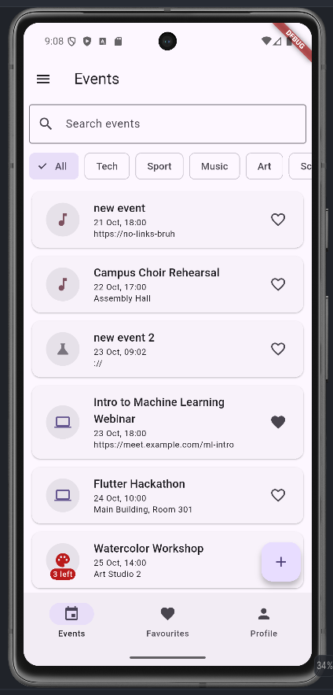
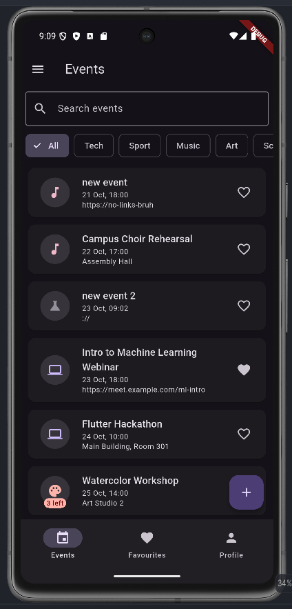
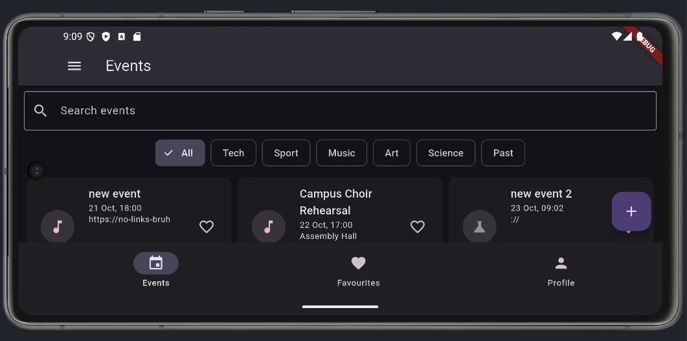

# Campus Events

Campus events with a title, category, start time and place (or a link when online). Each event has a capacity, and "Register" adds your profile name to its attendees.

## Screenshots

| Phone, light | Phone, dark | Tablet, grid |
|---|---|---|
|  |  |  |

## Decisions

The event list and the profile live in the shell's State, so every tab and pushed screen shares one source of truth and changes it only through callbacks. The detail screen takes callbacks because it changes an existing event in place (register, edit, delete), and the shell must see each change at once. The form only creates a value, so it returns an `Event` through `pop` and the caller decides what to do with it. The grid uses `LayoutBuilder` because the breakpoint depends on the space the list actually gets, not the whole screen that `MediaQuery` reports. `PopScope` compares a record of the current field values with the record taken when the form opened, so only real changes ask "Discard changes?". With week 9's tools I would move this state out of the shell into a shared state object and keep the data in local storage so it survives a restart.
